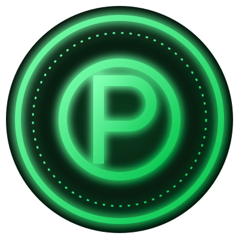

<!-- ============================================================ -->
<!--        PERFIL GITHUB • TROPA DOS LANTERNAS VERDES            -->
<!-- ============================================================ -->

<div align="center">





<br/>


</div>

<br/>

```diff
+ ╔═══════════════════════════════════════════════════════════╗
+ ║  🟢  TROPA DOS LANTERNAS VERDES  •  ANEL: 100% CARREGADO  🟢 ║
+ ║        OFICIAL: PEDRO LEMOS  •  ESPECIALIDADE: .NET + REACT   ║
+ ╚═══════════════════════════════════════════════════════════╝
```

## 🟢 &nbsp;Ficha do Lanterna


E aí! 👋 Eu sou o **Pedro**, **desenvolvedor Full Stack** com foco em **.NET e React**, e você acabou de pousar no meu setor.

Na Tropa, a regra é simples: **força de vontade é o melhor compilador**. Se dá pra imaginar, dá pra construir. 💚

- 🛡️ **Patrulha:** back-ends robustos com **C# / .NET** e front-ends rápidos com **React**
- 🔭 **Missão atual:** construir sistemas completos, do banco de dados à interface
- 🌱 **Treinamento:** sempre evoluindo (o anel nunca descarrega)
- 💬 **Pergunte-me sobre:** APIs, arquitetura, front-end e como criar soluções de ponta a ponta
- ⚡ **Poder:** transformar ideias em aplicações que funcionam de verdade

<br/>

## 💍 &nbsp;Arsenal do Anel (Tech Stack)

<div align="center">


<br/><br/>


</div>

<br/>

## 📊 &nbsp;Painel de Energia (GitHub Stats)

<div align="center">


<br/>


<br/>


</div>

<br/>

## 🏆 &nbsp;Condecorações da Tropa

<div align="center">


<br/>


</div>

<br/>

## 🌌 &nbsp;Missões em Andamento

| 🎯 Missão | 📈 Progresso |
|-----------|--------------|
| Dominar o ecossistema **.NET** |  |
| Interfaces poderosas com **React** |  |
| Arquitetura e boas práticas |  |

<br/>

## 📡 &nbsp;Canal de Comunicação da Tropa

<div align="center">

<a href="https://www.linkedin.com/in/pedro-henrique-lemos-santimaria-990b2a262/"></a>
<a href="mailto:pedrohlemossanti@outlook.com"></a>

</div>

<br/>

<div align="center">


### 💚 *"Onde há vontade, há código."* 💚


<sub>Feito com 💚, café e muita força de vontade • Obrigado pela visita, recruta!</sub>

</div>
